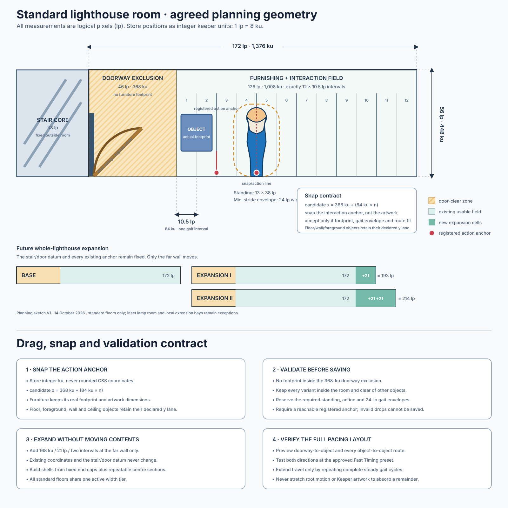

# Keeper room grid: 172 × 56 implementation handoff

_Agreed by Frank on 14 October 2026. This is the target geometry for Claude's
drag-and-drop and snap-to-grid work. It does not itself resize the current
110 × 56 studio or replace the historical 110 × 35/105 × 35 art._

> **Stair-core correction under review (14 October):** the `38 lp` stair core
> in the original diagram was a spatial placeholder, not a tread calculation.
> A new measured construction proposal uses a separate `105 lp` core, sixteen
> `3.75 lp` risers and sixteen `5.25 lp` advances over a `60 lp` finished-floor
> pitch. It is reviewable at `/keeper-review/keeper-vertical-circulation-v1/`
> and specified in
> `docs/CODEX_TO_CLAUDE_VERTICAL_CIRCULATION_2026-10-14.md`. The agreed
> `172 × 56` room interior is unchanged. Do not implement either stair width
> until Frank approves the new circulation geometry.

## Authoritative dimensions

Use keeper units (`ku`) for stored geometry. One logical pixel is 8 ku, so no
half-logical-pixel value needs to be stored as a float.

| Measurement | Logical pixels | Keeper units |
| --- | ---: | ---: |
| Initial standard room width | 172 | 1,376 |
| Standard room height | 56 | 448 |
| Historical stair-core placeholder (not implementation-ready) | 38 | 304 |
| Doorway exclusion from the stair-side wall | 46 | 368 |
| Usable furnishing/interaction field | 126 | 1,008 |
| Locomotion/snap pitch | 10.5 | 84 |
| Intervals in the usable field | 12 | 12 × 84 |
| Whole-lighthouse expansion increment | 21 | 168 |
| Expansion I width | 193 | 1,544 |
| Expansion II width | 214 | 1,712 |

The room coordinate origin is the stair-side inside wall. The room occupies
`x = 0..1376 ku`. The original sketch placed a provisional stair core at
`x = -304..0 ku`; the measured candidate would instead occupy
`x = -840..0 ku`. This negative-side correction does not move any room or
furniture coordinate. The first `368 ku` of the room is the doorway exclusion.
No furniture footprint may intrude into it.

The initial usable field is therefore `x = 368..1376 ku`. It contains twelve
84-ku planning intervals. The far boundary is a wall, not automatically a
valid Keeper centre point; ordinary collision and gait-envelope clearance
still apply.

## Drag-and-drop contract

1. Each draggable object declares its real artwork bounds, collision footprint,
   placement lane and one or more interaction anchors relative to the object.
2. The interaction anchor—not the object's artwork origin—snaps to the common
   lattice:

   `candidate_x_ku = 368 + (84 × n)`

3. The object retains its real dimensions. Furniture does **not** become a
   10.5-pixel tile and must never be rescaled to fill grid cells.
4. A candidate is accepted only when all variants of the object:
   - remain outside the 368-ku doorway exclusion;
   - remain inside the current room width;
   - clear walls, other footprints and permanent architecture;
   - leave the Keeper's declared standing/action envelope unobstructed;
   - expose at least one reachable interaction anchor;
   - produce an integral 84-ku route from every connected registered Keeper
     anchor.
5. Floor-standing, foreground, wall-mounted and ceiling-mounted items keep
   declared `y` lanes or mounting rails. The locomotion lattice quantises the
   horizontal interaction anchor; it is not a universal two-dimensional tile
   grid.
6. Invalid positions stay visibly invalid and cannot be saved. The interface
   should show the footprint, action anchor and nearest valid snap position
   while an object is being dragged.
7. Save integer `ku` coordinates, the room-width tier and the selected
   interaction-anchor identifier. Do not save rounded CSS pixels.

## Keeper clearance

The planning reference supplied with the width decision is 38 lp tall and
13 lp wide standing, with a 24 lp maximum horizontal mid-stride envelope.
Placement validation must use the appropriate pose/action envelope rather than
the narrower standing silhouette alone.

An object's interaction anchor may sit on a lattice line while its artwork
extends between or across several intervals. For a wall-facing object, the
last internal lattice line can provide the Keeper's stance while the object
occupies the remaining interval up to the far wall.

## Expansion behaviour

Initial standard rooms are `172 × 56 lp`. A global width upgrade adds 21 lp,
exactly two locomotion intervals:

- Base: 172 lp / 1,376 ku
- Expansion I: 193 lp / 1,544 ku
- Expansion II: 214 lp / 1,712 ku

The stair-side origin, doorway exclusion and all existing object/interaction
coordinates remain fixed. Expansion moves only the far wall and exposes two
new lattice intervals. Existing furniture and room art are never stretched,
rescaled or automatically redistributed.

Room shells therefore need fixed left and right caps with a repeatable centre
section. All standard stacked floors share the active width tier. The inset
lamp room, roof and explicitly declared local extension bays remain separate
geometry and do not redefine the standard width.

## Pacing and route verification

The editor should preview routes using the approved Fast Timing preset and the
same animation assembler used by the game. It must test:

- doorway transfer anchor to every interaction anchor;
- every valid interaction-anchor pair in the room;
- both travel directions;
- walk start, repeated steady gait, walk stop and any required turn;
- the compact starting layout, a fully furnished layout and every expansion
  tier.

Longer distances are produced only by repeating whole steady gait cycles.
Neither the Keeper artwork nor individual-frame root motion may be stretched
to cover a room-width remainder.

The direct same-room locomotion proposal remains subject to its own visual
approval. This room contract does not silently promote the proposed 84-ku
lattice, root-motion amendments or opposite-foot stop into production.
